  
  
   
  
  

 

### 📌 Sobre Mim
Desenvolvedor Full Stack e Designer focado em criar soluções completas com alta performance e design refinado. Atualmente cursando **Análise e Desenvolvimento de Sistemas (UFRN)**, formado **Técnico em Informática (IFRN)** e com especialização em **Desenvolvimento Web (IMD-UFRN)**. Fundador da **Void Studio**, combinando arquitetura técnica e experiência do usuário.

 

  

 

### ⚡ Principais Habilidades

| Área | Tecnologias & Ferramentas Chave |
| :--- | :--- |
| **Front-end & Mobile** |        |
| **Back-end & Dados** |      |
| **IA & Infraestrutura** |     |
| **Design & UX/UI** |     |

 

  

 

### 🚀 Projetos em Destaque

<table>
  <tr>
    <td width="50%" align="center" valign="top">
       
      
        
      
Estúdio de desenvolvimento e design criando produtos digitais de alta escala, experiências interativas 3D e interfaces contemporâneas.

      

        
        
        
      

    </td>
    <td width="50%" align="center" valign="top">
       
      
        
      
Ecossistema clínico digital (Web + Mobile + Admin) integrado à API oficial do <strong>Banco do Brasil</strong> para conciliação bancária automatizada.

      

        
        
        
        
      

    </td>
  </tr>
  <tr>
    <td width="50%" align="center" valign="top">
       
      
        
      
Plataforma de inteligência de dados agrícolas desenvolvida para a <strong>EAJ / UFRN</strong> e apresentada na convenção <strong>GO!RN (EliAgro)</strong>.

      

        
        
        
      

    </td>
    <td width="50%" align="center" valign="top">
       
      <h3>🏠 Homelab & IA Privada</h3>
       
      
Infraestrutura própria de servidor local bare-metal dedicada à automação analítica e execução autônoma de LLMs locais via hardware dedicado.

      

        
        
        
      

    </td>
  </tr>
</table>

 

  

 

### 📈 Estatísticas do GitHub

  
  

 

  

 

  

